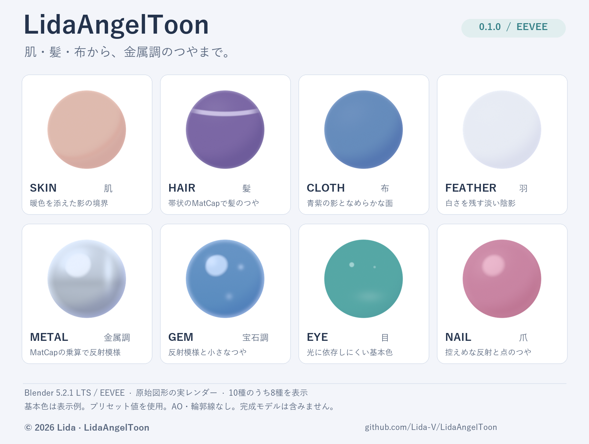
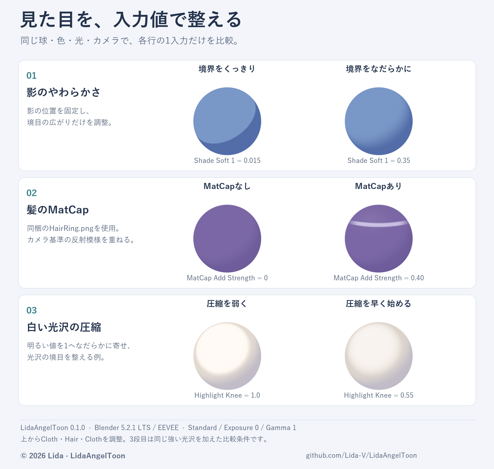

# LidaAngelToon

**やわらかい影と、髪・布・金属などの描き分けを、Blender EEVEEで。**
LidaAngelToon 0.1.0は、明るい部分と2段の影をなめらかにつなぐトゥーンシェーダーです。10種類のプリセットから材質に合うものを選び、光沢や影の色を調整できます。



上図は公開版0.1.0を同じUV球へ適用した、代表8種の実レンダーです。基本色は表示例で、照明・カメラは共通、AO・輪郭線は使っていません。人物モデルの完成例ではなく、素材の見え方を確かめる資料です。色・形・照明によって見え方は変わります。詳しい条件は[画像資料](docs/images/README.md)を参照してください。

**[インストール用ZIPを取得](https://github.com/Lida-V/LidaAngelToon/releases/download/v0.1.0/lida_angel_toon-0.1.0-addon.zip)** · [Release 0.1.0](https://github.com/Lida-V/LidaAngelToon/releases/tag/v0.1.0) · [詳しい導入手順](docs/INSTALL.md)

対応は **Blender 5.2.1 LTS / EEVEE**。モデル本体は含みません。

## 初めて使う

1. 上のリンクから `lida_angel_toon-0.1.0-addon.zip` を取得します。ソースZIPは開発者向けです。
2. Blenderの「編集 → プリファレンス → アドオン → ディスクからインストール」で、そのZIPを展開せずに選びます。LidaAngelToonを有効にします。
3. レンダーエンジンを **EEVEE** にします。まず球を1つ追加し、3Dビューで `N` キーを押して **LidaAngelToon** を開きます。
4. `Cloth`を選び、`Apply to selected meshes`を押します。「レンダー」表示にすると見えます。Sunがなければ1個作ります。

Principled BSDFから出力する基本的な材質を対象に、既存の基本色や画像の接続を引き継ぎます。各選択メッシュの**アクティブ材質だけ**が対象なので、複数の材質があるモデルは材質ごとに選んで適用します。材質名や形状から肌・顔・髪を自動判定する機能はありません。

元のノードは残し、`Restore original material`で元の出力へ戻せます。生成済みのノードや画像などは残るため、適用前のファイルも保存してください。

詳しい導入・更新：[INSTALL](docs/INSTALL.md)。対応と制限：[SUPPORT](docs/SUPPORT.md)。
実際に確認した範囲：[VALIDATION](docs/VALIDATION.md)。

## 見た目をどう整えられるか

- **影をやわらかくする**：影の境目・幅・色を調整し、肌や布の丸みを見せます。
- **素材ごとにつやを変える**：髪の輪状の光沢、金属・宝石・目の光沢などをMatCap画像で表現します。自作MatCap5枚を収録しています。
- **肌の印象を整える**：明暗の境目の色味を整え、基本色の明るさや彩度も調整できます。
- **縁や明るさを整える**：縁の光、小さなつや、白い部分の明るさをなだらかに抑える`Highlight Knee`、任意の輪郭線を使えます。
- **必要な箇所へ補助情報を足す**：利用者が用意したAO属性や、付属の毛筋マスクを使えます。髪の毛筋は**UVが必要**で、UVのV方向を髪の長さ方向へ合わせます。



上から、影のやわらかさ（`Shade Soft 1`）、髪のMatCapの強さ（`MatCap Add Strength`）、明るい白の圧縮（`Highlight Knee`）の比較です。各行の左右は形・色・照明・カメラを揃え、1項目だけを変えています。3段目は効果を見せるため、左右とも同じ強い光沢を加えた例です。値と描画条件は[画像資料](docs/images/README.md)に記載しています。

MatCapは、見る方向に応じた画像でつやを加える表現です。金属や宝石のプリセットも、この方法でそれらしい見た目を作ります。実物の金属の反射計算や、宝石内部の透過・屈折を再現する機能ではありません。

## 10種類のプリセット

プリセットは仕上がりを調整する出発点です。対象の部位を自分で選び、基本色・テクスチャ・照明と合わせて使います。

| パネルの名前 | 向いている箇所・見た目 |
|---|---|
| `Cloth` | 服や布。控えめなつやとやわらかい影 |
| `Skin` | 身体の肌。暖かい影と明暗の境目の色 |
| `Face` | 顔の肌。控えめな縁の光と、明るい基本色 |
| `Hair` | 髪。輪状の光沢。毛筋マスクは任意で追加 |
| `Metal` | 金属の装飾。MatCapによる明暗と小さなつや |
| `Gem` | 宝石風の装飾。明るい光沢と縁の光 |
| `Eye` | 目。影を控え、基本色と光沢を見せる |
| `Nail` | 爪。暖かい色の影と小さなつや |
| `Feather` | 羽。薄い色の影と控えめな縁の光 |
| `Mouth` | 口内など。赤みのある影と控えめな明暗 |

材質の細かな値はShader Editorの`LidaAngelToon`ノードで調整します。**プリセットを再適用すると、手動で調整したノードの値を上書きします。** 調整値を控えてから再適用してください。各操作の説明は[導入と更新](docs/INSTALL.md)、困ったときは[対応範囲と確認方法](docs/SUPPORT.md)を参照してください。

## 対応範囲

**Blender 5.2.1 LTS / EEVEEで検証済み。** Cycles、他のBlender版、Unity、Unreal Engineは未対応・未検証です。Unity/UE実装やVRMへの自動変換は収録していません。Blenderで表示できることは、別の使用先で同じ見た目になる保証ではありません。

ランタイムに外部Pythonパッケージは不要です。AOは任意で、未指定なら1（奥の暗さなし）。顔の形や髪の頭頂を自動検出する処理はありません。形状・骨・ウェイト・表情は変更しません。輪郭線を選んだ場合のみSolidifyモディファイアと材質スロットを追加します。

## 配布条件と出典

[LICENSE](LICENSE)が適用範囲の案内、[NOTICE](NOTICE.md)が出典情報です。
Blenderアドオン／bpyを使うテストは **GPL-3.0-or-later**。自作画像・文書・Blenderに依存しない生成器は、同梱の **Lida Attribution License 1.0** が対象です。ファイルのSPDX表示も確認してください。

通常の描画画像や、シェーダーで作ったモデル成果へのクレジットは不要です。アプリ、配布コード、派生Skillsへ本資料やコードを組み込んで公開する際は、LICENSEとNOTICEの出典情報を残してください。GPL部分には独自ライセンスの追加制限を課しません。GPLのアドオンを使用しただけで、モデルや描画成果がGPLになるわけではありません。

## 開発者向け

```text
python -m unittest discover -s tests -p "test_*.py"
python scripts/validate_release.py
python scripts/build_release.py
```

配布ZIPは `dist/` へ作成します。`manifest.json` のallowlistだけを梱包し、モデル・FBX・VRM・参考モーション・外部素材を拒否します。依存ライブラリを同梱しません。

手続き画像を再生成する場合だけ `python -m pip install -r requirements-dev.txt`、続いて `python tools/generate_textures.py` を実行します。

Blender本体で原始図形の描画・保存・再読込を確認する例：

```text
blender --background --factory-startup --python tests/blender_smoke.py -- --output dist/smoke
```

検査は任意のモデルを開かず、球と自作テクスチャだけで行います。検査用blendと中間PNGは公開ZIPに含めません。README掲載用の比較画像は`docs/images/`に置いています。
