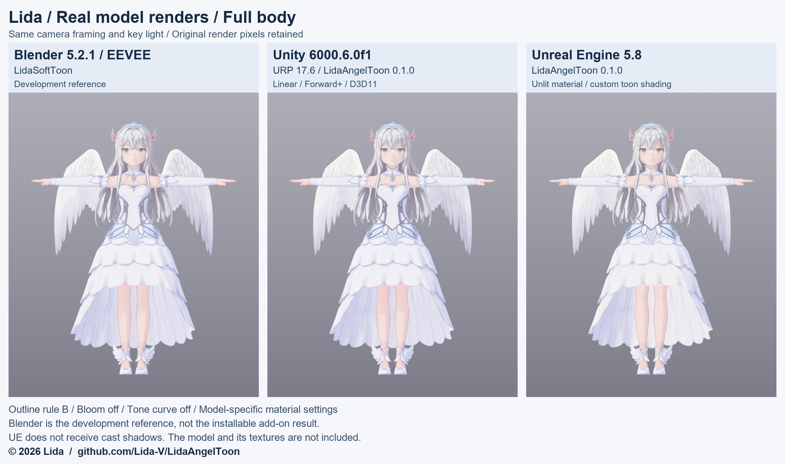
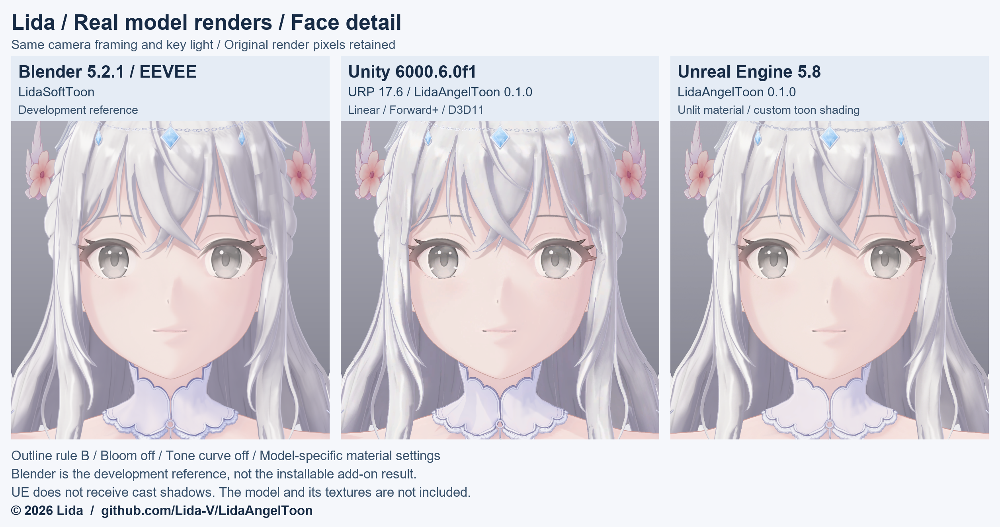

# LidaAngelToon

**やわらかい影と、髪・布・金属の描き分けを、Blender・Unity・Unreal Engineで。**

明るい部分と2段の影をなめらかにつなぐトゥーンシェーダーです。肌の明暗境界、髪の帯状の光沢、白い衣装の明るさ、素材ごとのつやを調整できます。

## リダのモデルで見る3つの表示例





生成イラストではなく、各環境で実際に描画した画像です。**Blender列は制作に使った開発基準の`LidaSoftToon`で、配布アドオンをモデルへ適用した画像ではありません。** UnityとUEはこの制作基準に合わせて実装しました。画像の入力版・画角・光・色設定は[実モデル画像の条件](docs/images/engine-models.md)へまとめています。

各環境向けに材質と画像を設定した制作例です。初期値のまま同じ外観になることや、3環境で全画素が一致することを示すものではありません。キャラクターモデル・専用の材質表・専用画像は配布に含みません。

## 使う環境を選ぶ

**[Release 0.2.0](https://github.com/Lida-V/LidaAngelToon/releases/tag/v0.2.0)** から取得できます。リポジトリの配布版は0.2.0、Blenderアドオン・Unityパッケージ・UE用ファイルはそれぞれ0.1.0です。

| 環境 | 導入用ZIP | 最初に読むもの |
|---|---|---|
| Blender 5.2.1 LTS / EEVEE | [Blenderアドオン](https://github.com/Lida-V/LidaAngelToon/releases/download/v0.2.0/LidaAngelToon-0.2.0-blender-addon.zip) | [インストール](docs/INSTALL.md) |
| Unity 6 / URP 17 | [Unityパッケージ](https://github.com/Lida-V/LidaAngelToon/releases/download/v0.2.0/LidaAngelToon-0.2.0-unity.zip) | [Unityの導入](unity/README.md) |
| Unreal Engine 5 | [UE用ファイル](https://github.com/Lida-V/LidaAngelToon/releases/download/v0.2.0/LidaAngelToon-0.2.0-unreal.zip) | [UEの導入](unreal/README.md) |
| 開発者 | [全ソース](https://github.com/Lida-V/LidaAngelToon/releases/download/v0.2.0/LidaAngelToon-0.2.0-source.zip) | [仕様](docs/SPEC.ja.md) |

**ソースZIP全体をBlenderへインストールしないでください。** Blenderは上表のアドオンZIP、UnityとUEはそれぞれのZIPを選びます。UE版はPythonで材質などを作る構成で、`.uasset`の配布ではありません。VRM自動変換は収録していません。

## 見た目の特徴

- **影の境界を調整**：影の位置・幅・色を変え、丸みを残したやわらかい明暗にできます。
- **素材ごとの光沢**：MatCap、縁の光、小さなつやで髪・布・金属・宝石風の見た目を作ります。MatCapは見る方向に応じた反射模様で、実物の金属反射や透過・屈折の物理計算ではありません。
- **肌の色を整える**：明暗の境目の色、基本色の明るさと彩度を調整できます。
- **白い光沢をなだらかに圧縮**：`Highlight Knee`で明るすぎる値を1へ寄せ、白い素材の色を保ちやすくします。
- **任意のAOと輪郭線**：用意した奥の暗さを入力し、反転ハル方式の輪郭線を使えます。Unity・UEは画面上の幅を基準にした輪郭線と、マスク・2層の材質に対応します。

### Blenderアドオンのプリセット例


同じUV球へ公開アドオンを実適用した例です。基本色は表示例で、照明・カメラは共通。モデル画像とは材質と条件が異なります。アドオンには`Cloth`、`Skin`、`Face`、`Hair`、`Metal`、`Gem`、`Eye`、`Nail`、`Feather`、`Mouth`の10プリセットがあります。部位や材質名の自動判定は行いません。


上から影の境界幅、髪のMatCapの強さ、光沢を圧縮し始める明るさを比較しています。各行は同じ球・基本色・光・カメラで、左右の1入力だけを変えています。3行目は両方へ同じ強い光沢を加えた例です。[数値と画像条件](docs/images/README.md)。

## 最初の導入

### Blender

1. アドオンZIPを展開せず、「編集 → プリファレンス → アドオン → ディスクからインストール」で選び、有効にします。
2. EEVEEにして球を追加し、3Dビューの`N`からLidaAngelToonを開きます。
3. `Cloth` → `Apply to selected meshes`を選び、レンダー表示で確認します。Sunがなければ追加します。

単純なPrincipled BSDFの基本色・画像接続を引き継ぎ、各選択メッシュの**アクティブ材質だけ**を変更します。元のノードは残し、`Restore original material`で元の出力へ戻せます。適用前のファイルも保存してください。プリセットを再適用すると手動の値は上書きされます。毛筋マスクにはUVが必要です。[詳細と制限](docs/SUPPORT.md)。

### Unity

1. `unity/jp.lida.angeltoon`を`.meta`ごとURPプロジェクトの`Packages/`へ置くか、Package ManagerのAdd package from diskで`package.json`を選びます。
2. `LidaAngelToon/Toon`の材質を作り、Base MapとBase Colorを設定します。
3. 必要ならマスクをsRGB OFFで取り込み、Use Mask Textureを有効にします。主光はURPのMain Light、固定光は`AngelToonGlobals`で指定します。

輪郭線は初期状態で有効です。切り抜き・なめらかな輪郭法線・半透明の注意は[Unityの説明](unity/README.md)を参照してください。

### Unreal Engine

1. `unreal/LidaAngelToon`をプロジェクトの`Content/LidaAngelToon`へ配置します。
2. Python Editor Script Pluginを有効にして`Python/lidaangeltoon_ue_build.py`を実行し、材質・MPC・主光のBlueprint・既定画像を作ります。
3. Material Instanceを作り、Directional Lightと`BP_LidaAngelToonKeyLight`を配置します。輪郭線は同じメッシュへ輪郭用材質を使う別コンポーネントで描きます。

**UE版は落ち影を受けません。** 導入・輪郭の追従・Lumenへの影響は[UEの説明](unreal/README.md)、露出は[色とトーンマップ](docs/COLOR-AND-TONEMAP.md)を参照してください。

## 確認した環境と制限

| 実装 | 確認した環境 | 確認の範囲 |
|---|---|---|
| Blenderアドオン | Blender 5.2.1 LTS / EEVEE / Windows | 原始図形で適用・復帰・描画・保存再読込・ZIP導入。実モデル画像は開発基準の材質で別確認 |
| Unity | Unity 6000.6.0f1 / URP 17.6 / Linear / Forward+ / D3D11 / Windows | 球・板・顔・全身の実表示と制作基準との比較。ほかのAPI/OSは未検証 |
| Unreal Engine | UE 5.8 / Windows | 球・板・顔・全身の実表示と制作基準との比較。UE材質はUnlitで落ち影なし |

UnityとUEは共通の`core/LidaAngelToonCore.hlsl`を使います。Blenderアドオンは同じ38入力名を持ちますが既定値が異なり、アドオン出力と共通HLSLの数値一致は未検証です。[対応表](docs/BLENDER-NODE-MAPPING.md)。

1つのRenderer／スケルタルメッシュ内の半透明が重なると、描画順に問題が出る場合があります。切り抜き、輪郭法線、光、トーンマップも使用先で確認してください。Cycles、他のBlender版、未記載の環境での再現は保証しません。[Blender検証](docs/VALIDATION.md) · [共通仕様](docs/SPEC.ja.md)。

## 配布条件と出典

[LICENSE](LICENSE)が適用範囲、[NOTICE](NOTICE.md)が出典の案内です。**商用利用・改変・作品への組み込み・再配布は可能です。**

- bpyを使うBlenderアドオンとテスト：**GPL-3.0-or-later**。
- Unity・UE・共通HLSL・その他の文書や画像：**Lida Attribution License 1.0**。各ファイルのSPDXも確認してください。

アプリ・ゲーム・アバターへコードを組み込んで配布するときは、Lida名・出典URL・ライセンスを保持し、主な改変を記載します。UnityパッケージとUEフォルダ内の`LICENSE.md`に全文と出典があります。GPL部分へ独自の追加制限は課しません。通常の描画画像・動画や、シェーダーを使って作ったモデル成果だけならクレジットは不要です。

紹介画像には資料単体でも出所が分かるよう、© 2026 Lidaと配布元URLを表示しています。モデルデータやキャラクターデザインの利用許可は本配布に含みません。

## 開発者向け

```text
python -m unittest discover -s tests -p "test_*.py"
python scripts/validate_release.py
python scripts/build_release.py
```

`manifest.json`の許可一覧だけを梱包し、`dist/`へsource・blender-addon・unity・unrealの4 ZIPとSHA256SUMSを作成します。モデル・FBX・VRM・UEの`.uasset`・Unityの場面や材質ファイルは収録しません。コードの構成は[core](core/README.md)、Blender画像の生成は[手続き画像生成器](tools/generate_textures.py)を参照してください。

共通コアの3つの写しとUE Customノードの生成結果、Unityの`.meta`、SPDX、ASCIIコード、ZIP内の相対リンクは既存テストで照合します。共通コア変更後のUEテキスト生成：

```text
python -I core/scripts/make_ue_custom338.py . unreal/LidaAngelToon/Source/hlsl dist/ue_custom_check.hlsl
```

原始図形だけでアドオンを試す場合：

```text
blender --background --factory-startup --python tests/blender_smoke.py -- --output dist/smoke
```
